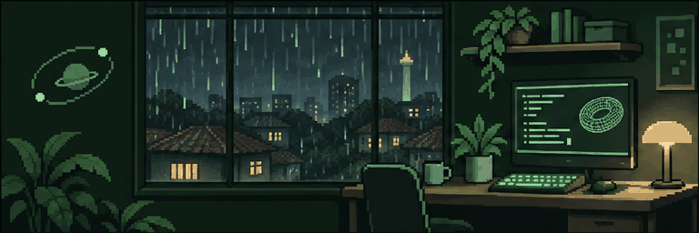

  <picture>
    <source media="(prefers-reduced-motion: reduce)" srcset="./asset/coding-studio-still.png" />
    
  </picture>

  
  
  
  
  
  
  

  <picture>
    <source media="(prefers-color-scheme: dark)" srcset="https://raw.githubusercontent.com/IqbalMaulMaul/IqbalMaulMaul/output/github-snake-dark.svg" />
    
  </picture>

